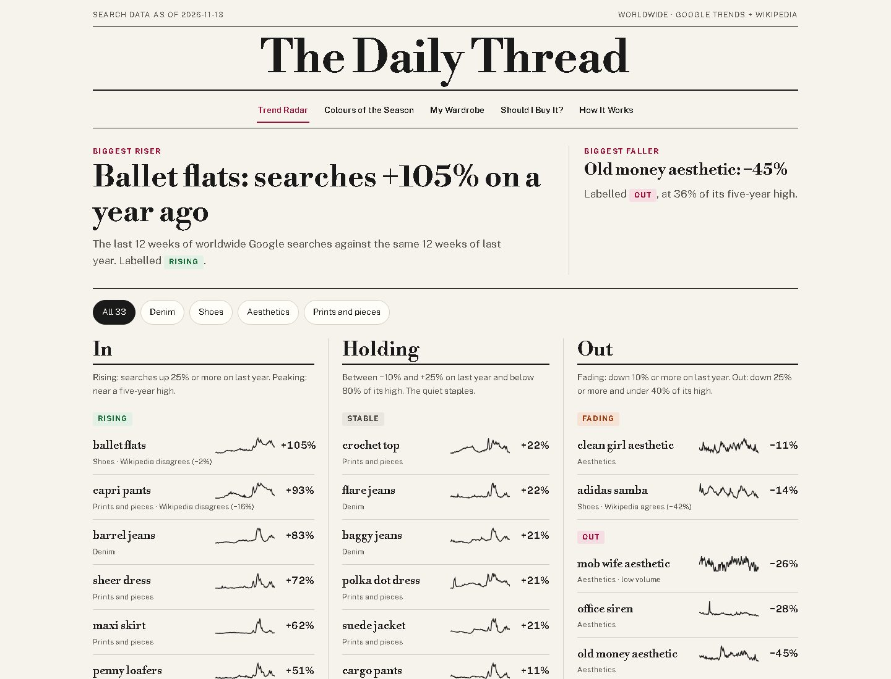
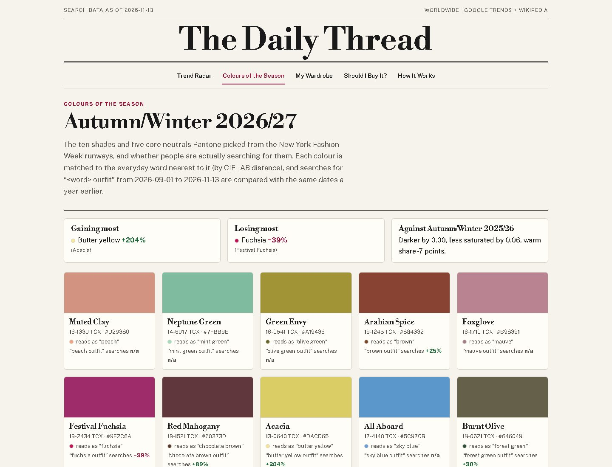

<div align="center">

```
██████╗  █████╗ ██╗██╗  ██╗   ██╗  ████████╗██╗  ██╗██████╗ ███████╗ █████╗ ██████╗
██╔══██╗██╔══██╗██║██║  ╚██╗ ██╔╝  ╚══██╔══╝██║  ██║██╔══██╗██╔════╝██╔══██╗██╔══██╗
██║  ██║███████║██║██║   ╚████╔╝█████╗██║   ███████║██████╔╝█████╗  ███████║██║  ██║
██║  ██║██╔══██║██║██║    ╚██╔╝ ╚════╝██║   ██╔══██║██╔══██╗██╔══╝  ██╔══██║██║  ██║
██████╔╝██║  ██║██║███████╗██║        ██║   ██║  ██║██║  ██║███████╗██║  ██║██████╔╝
╚═════╝ ╚═╝  ╚═╝╚═╝╚══════╝╚═╝        ╚═╝   ╚═╝  ╚═╝╚═╝  ╚═╝╚══════╝╚═╝  ╚═╝╚═════╝
```

### A Fashion Trend Radar: What Is In, What Is Out, and the Colours of the Season, from Live Search Data

[](https://python.org)
[](https://flask.palletsprojects.com)
[](https://trends.google.com)
[](https://doc.wikimedia.org/generated-data-platform/aqs/analytics-api/)
[](https://sqlite.org)
[](tests/)



</div>

---

## Table of Contents

- [Overview](#overview)
- [What changed in the November 2026 revision](#what-changed-in-the-november-2026-revision)
- [How It Works](#how-it-works)
- [Results](#results)
- [Getting Started](#getting-started)
- [Data and Licences](#data-and-licences)
- [Challenges and Solutions](#challenges-and-solutions)
- [Roadmap](#roadmap)
- [Author](#author)

---

## Overview

The Daily Thread reads public search data and tells you, in newspaper form:

1. **What is in and what is out.** 36 fashion terms (denim cuts, shoes, aesthetics, pieces), each labelled Rising, Peaking, Stable, Fading or Out from five years of weekly Google Trends data, with Wikipedia page views as a second opinion.
2. **The colours of the season.** Pantone's New York Fashion Week palette for the current season, whether people are actually searching for those colours compared with a year ago, what changed from last season's palette, and a preview of next season.
3. **Whether to buy it.** A wardrobe you can fill in and a five-question purchase check that scores a planned buy, using the radar (buying a Rising style means buying near the top of the hype).

Every label comes from a written rule, shown on the site's How It Works page.

## What changed in the November 2026 revision

| Before | After |
|---|---|
| Repo could not run: HTML files at the root, no `templates/` or `static/` | Standard Flask layout, one command to run |
| "Trends" from synthetic Kaggle sets and mock CSVs (about 14 MB committed) | Live Google Trends and Wikipedia data, saved as dated snapshots; synthetic data removed |
| Wardrobe and purchase history kept in the session cookie (about 4 KB cap, items silently dropped) | SQLite, keyed to an anonymous per-browser id |
| No notion of "in" or "out" | Five labels from year-on-year change and distance from the five-year high |
| No colour analysis | Pantone palettes for four seasons, mapped to everyday colour words by CIELAB distance, with search interest year on year |
| Reddit feed needing API keys, unused TensorFlow dependency, emoji README | Removed |
| No tests | pytest suite for the label rules, colour maths and every page |

## How It Works

```
data/terms.json ──┐                                   ┌──► Trend Radar  (In / Holding / Out)
                  ├─► scripts/refresh_trends.py ──────┤
Pantone reports ──┤     Google Trends, 5 y weekly     │    thread/trends.py
 (build_palettes) │     Wikipedia, monthly views      ├──► Term page    (chart + signals)
                  │            │                      │
data/palettes.json┘            ▼                      │    thread/colours.py
                     data/snapshots/YYYY-MM-DD.json ──┼──► Colours of the Season
                                                      │
                     data/thread.db (SQLite) ─────────┴──► Wardrobe, Should I Buy It?
```

**Trend label.** For each term's weekly series (Google's 0 to 100 scale, the unfinished week dropped):

| Signal | Definition |
|---|---|
| Year on year | mean of the last 12 weeks vs the same 12 weeks a year earlier (cancels seasonality) |
| Share of high | last 12 weeks vs the busiest 12-week stretch in five years |
| Momentum | slope of the last 12 weeks, as % of their mean per week (shown, not used in the label) |

| Label | Rule (checked in this order) |
|---|---|
| Rising | year on year +25% or more |
| Out | year on year -25% or less and under 40% of the five-year high |
| Fading | year on year -10% or less |
| Peaking | 80% or more of the five-year high |
| Stable | anything else |

Terms averaging under 5 on Google's scale are flagged low volume. If the term has a Wikipedia article, the last three months of views against the same months a year earlier is shown beside the label, with whether it points the same way.

**Colours.** Nobody searches for "Arabian Spice", so each Pantone colour is matched to the nearest of about 40 everyday colour words ("rust", "sage green") by Delta E in CIELAB. Searches for "&lt;word&gt; outfit" during the season are compared with the same dates a year earlier. Palettes are summarised by mean HSL lightness and saturation and by warm, cool and neutral shares.

**Snapshots.** Google rate-limits scripted requests, so the app never calls it live. `scripts/refresh_trends.py` saves a dated snapshot (resumable: a re-run fetches only what is missing) and the app reads the newest one.

## Results

From the committed snapshot of 13 November 2026 (worldwide). Reproduce with `python scripts/summarise.py`.

**Coverage.** 33 of 36 terms (Google blocked *barn jacket*, *bomber jacket* and *trench coat* after repeated retries), 17 of 36 colour words, 15 Wikipedia articles. Missing data shows as "n/a" on the site; the next refresh fills it.

**Labels:** 11 Rising, 2 Peaking, 15 Stable, 2 Fading, 3 Out.

| Biggest risers | Year on year | | Biggest fallers | Year on year |
|---|---|---|---|---|
| ballet flats | +105% | | old money aesthetic | -45% (Out) |
| capri pants | +93% | | office siren | -28% (Out) |
| barrel jeans | +83% | | mob wife aesthetic | -26% (Out, low volume) |
| sheer dress | +72% | | adidas samba | -14% (Fading) |
| maxi skirt | +62% | | clean girl aesthetic | -11% (Fading) |

**The second signal disagrees more often than it agrees.** Wikipedia views point the same way as Google searches for only 5 of the 13 terms with both signals (for example *adidas samba*: Google -14%, Wikipedia -42%; *skinny jeans*: Google +38%, Wikipedia -26%). Encyclopaedia readers and shoppers are different audiences, so the site shows the Wikipedia figure beside each label instead of mixing it into the label.

**Colours of the season (Autumn/Winter 2026/27).** Searches for "&lt;word&gt; outfit" from 1 September to 1 November 2026 against the same weeks of 2025:

| Pantone colour | Reads as | Change | | Pantone colour | Reads as | Change |
|---|---|---|---|---|---|---|
| Acacia | butter yellow | +204% | | Toffee | brown | +25% |
| Red Mahogany | chocolate brown | +89% | | Egret | cream | +18% |
| Burnt Olive | forest green | +30% | | Candied Ginger | khaki | -4% |
| Arabian Spice | brown | +25% | | Festival Fuchsia | fuchsia | -39% |

Against last season (Spring/Summer 2026), the palette swapped beige, burgundy, plum, sage, teal and terracotta for browns, khaki, olive, mint, grey and fuchsia. Against the same season a year earlier (Autumn/Winter 2025/26) it is a little less saturated (0.39 vs 0.45) and less warm (67% vs 73%). Next season (Spring/Summer 2027) is the lightest and most saturated of the four (0.57 lightness, 0.56 saturation).

| Season | Lightness | Saturation | Warm | Cool | Neutral |
|---|---|---|---|---|---|
| Autumn/Winter 2025/26 | 0.50 | 0.45 | 73% | 20% | 7% |
| Spring/Summer 2026 | 0.51 | 0.41 | 62% | 31% | 6% |
| Autumn/Winter 2026/27 | 0.50 | 0.39 | 67% | 27% | 7% |
| Spring/Summer 2027 | 0.57 | 0.56 | 67% | 27% | 7% |



## Getting Started

```bash
pip install -r requirements.txt
python app.py                        # http://localhost:5004, reads the committed snapshot
python -m pytest                     # tests
```

Refresh the data (takes 10 to 20 minutes because of rate limits; re-run if some terms come back empty):

```bash
python scripts/refresh_trends.py     # writes data/snapshots/<today>.json
python scripts/summarise.py          # prints the tables in this README
python scripts/build_palettes.py     # re-reads the Pantone reports into data/palettes.json
```

Edit `data/terms.json` to track different terms.

## Data and Licences

| Data | Use | Terms |
|---|---|---|
| Google Trends, via [pytrends](https://github.com/GeneralMills/pytrends) 4.9.2 | Weekly search interest | Public Google data; pytrends is unofficial and archived (April 2025), so refreshes can break |
| [Wikimedia pageviews API](https://doc.wikimedia.org/generated-data-platform/aqs/analytics-api/) | Monthly article views | CC0 data, official API |
| [Pantone Fashion Color Trend Reports](https://www.pantone.com/fashion-color-trend-report), NYFW AW25/26, SS26, AW26/27, SS27 | Season palettes | Only colour names, codes and chip hex values are stored, with links to each report |

## Challenges and Solutions

| Challenge | Solution |
|---|---|
| Google Trends blocks scripted requests after a few dozen queries | Back-off and retry per query, resumable dated snapshots, and an app that only reads snapshots |
| Seasonal items (boots in October) look like trends | Compare the last 12 weeks with the same 12 weeks a year earlier, not with the previous 12 weeks |
| Google's numbers are relative, not absolute | Each term is fetched on its own, so year-on-year ratios are within one series |
| Pantone colour names aren't searched | Nearest everyday colour word by CIELAB distance; the distance is kept so poor matches are visible |
| Short spikes shared by unrelated terms (mid-February 2026) | Labels use 12-week means, so one odd week can't decide a label; noted on the site |
| pytrends' retry option breaks on urllib3 2 | Own retry loop with exponential back-off |

## Roadmap

- Pakistan as a second region (Google Trends `geo=PK`) beside worldwide.
- A scheduled weekly refresh (GitHub Actions) that commits the new snapshot.
- Reddit mentions as a third signal for users who add their own API key.
- The social side of the original idea: a feed where people post outfits and react, on top of the existing SQLite store. The original virtual pet is retired.
- Backtesting the labels: did terms labelled Rising a year ago keep rising?

## Author

**Abdul Rehman Faisal** · BS Data Science, GIKI (2027)
[GitHub](https://github.com/ARFaisal-Rehman) · [LinkedIn](https://linkedin.com/in/abdul-rehman-faisal-2a680b297)
